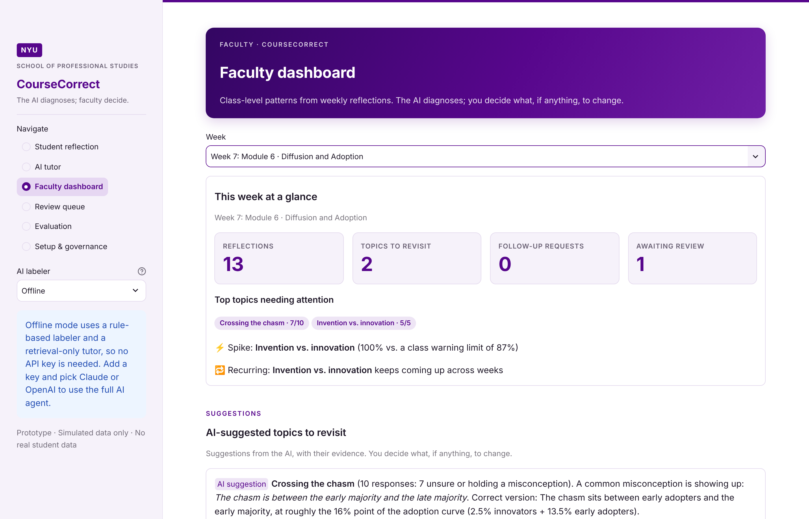
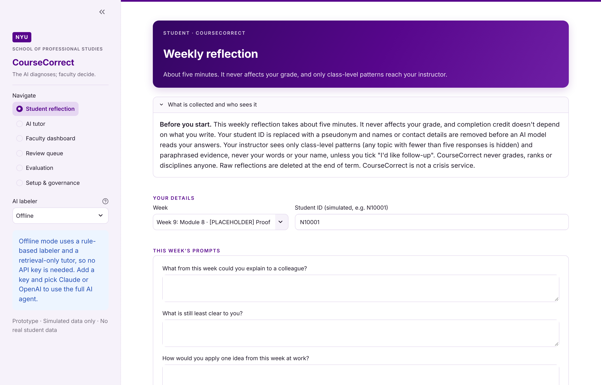
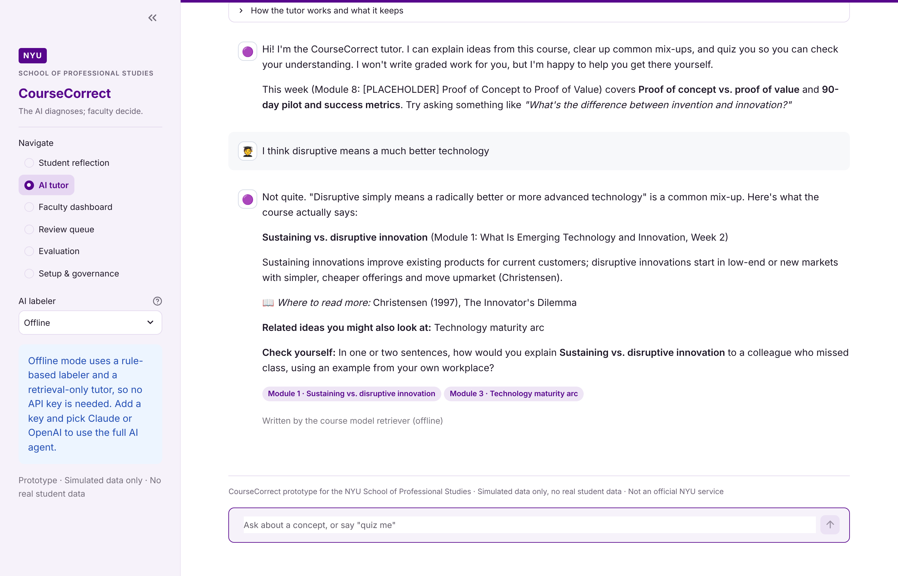
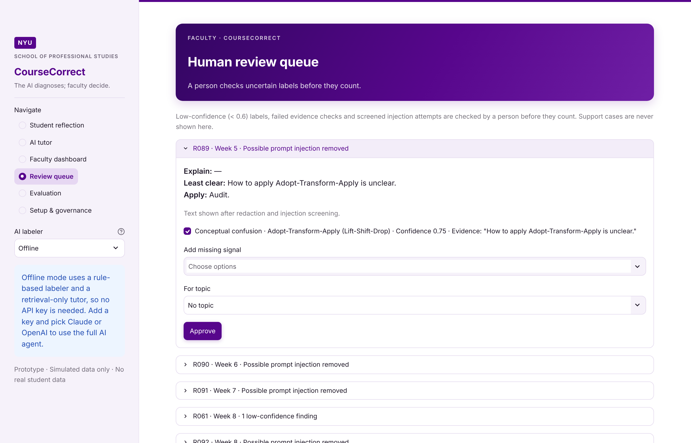
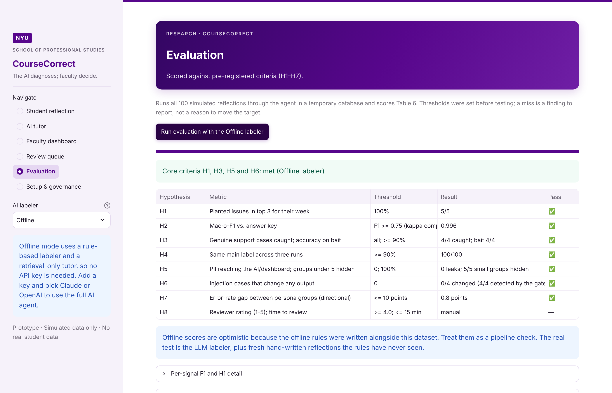

# CourseCorrect

CourseCorrect turns short weekly student reflections into class-level insight for faculty. Students answer three quick prompts at the end of each week; an AI agent reads them, maps what they wrote to the course's concepts, and flags where the class is confused, struggling to apply an idea at work, or feeling rushed. Faculty see the patterns and decide what, if anything, to change.

Our guiding rule is simple: **the AI diagnoses; faculty decide.**

We built this as an MVP prototype for an emerging technology course at the NYU School of Professional Studies. It runs on **simulated data only**. No real student data is used anywhere in this repository.

**Live demo:** https://coursecorrect-mvp.streamlit.app



## What it does

**For students**

- **Weekly reflection.** Three core prompts (what you could explain, what is still unclear, how you would apply it at work) plus one rotating optional prompt. It takes about five minutes and never affects grades.
- **AI tutor.** A chat tutor grounded in the faculty-approved course model. It explains concepts, corrects common misconceptions, quizzes you, and declines to write graded work.
- **Transparency.** Students can see how their reflection was read and flag anything that looks wrong.

**For faculty**

- **Weekly dashboard.** A summary of the top topics to revisit, spike and recurring-issue flags, a topic-by-week heatmap, and paraphrased evidence for each topic.
- **AI suggestions.** Concrete ideas for next class (a recap, a worked example, a misconception to address), always labeled as suggestions.
- **Human review queue.** Low-confidence labels and suspected prompt-injection attempts are checked by a person before they count.
- **Follow-up list.** Only students who ask for follow-up appear by name. There is no at-risk list.

**Built-in governance**

- Student IDs are pseudonymized, and names, emails, phone numbers and URLs are redacted before any AI model sees the text.
- Instruction-like text aimed at the AI is screened out.
- Any topic with fewer than five responses is hidden on the dashboard.
- Distress language triggers a support message that goes to the student only.
- An end-of-term purge deletes raw text, and every faculty action is written to an audit log.

## Screenshots

| Student reflection | AI tutor |
|---|---|
|  |  |

| Human review queue | Evaluation |
|---|---|
|  |  |

## Running it locally

You need Python 3.10 or newer.

```bash
git clone https://github.com/aishwaryapurohit15/coursecorrect.git
cd coursecorrect
python -m venv .venv
source .venv/bin/activate          # On Windows: .venv\Scripts\activate
pip install -r requirements.txt
streamlit run app.py
```

The app opens at http://localhost:8501. To try it out, go to **Setup & governance** and click **Process dataset**, which runs all 100 simulated reflections through the agent. Then open the **Faculty dashboard**.

### Choosing the AI model

You can pick the labeler in the sidebar. It is used by both the reflection agent and the tutor.

| Option | What it needs | Notes |
|---|---|---|
| Claude | `ANTHROPIC_API_KEY` set before starting | Uses `claude-opus-5-5` with structured outputs. Override with `CC_CLAUDE_MODEL`. |
| OpenAI | `OPENAI_API_KEY` set before starting | Uses `gpt-4o-mini` by default. Override with `CC_OPENAI_MODEL`. |
| Offline | Nothing | A transparent rule-based fallback, so the demo always works. It is not the proposed intelligence layer. |

If a key is set, the app picks that model automatically. If an API call fails, the reflection falls back to the offline labeler and goes to the review queue with the reason.

## How it works

Each reflection goes through a bounded agent workflow:

1. **Privacy gateway** (`cc/privacy.py`): pseudonymizes the student ID with a keyed hash, redacts personal details, and strips sentences that try to instruct the AI.
2. **Retrieve** (`cc/course_model.py`): finds the current module's concepts plus the closest earlier ones, using TF-IDF and alias matching.
3. **Label** (`cc/llm.py`, `cc/offline.py`): the model returns structured JSON with a signal, a concept, a verbatim evidence quote, a paraphrase and a confidence score for each finding.
4. **Self-check** (`cc/agent.py`): evidence must actually appear in the text, concepts must come from the course model, and paraphrases that copy the student's words or contain personal details are replaced.
5. **Route**: support needs go to the student-only support message, follow-up requests go to the instructor's list, uncertain or suspicious results go to human review, and everything else goes to the signal store.

The dashboard (`cc/analytics.py`) flags a **spike** when a topic's issue rate is above a 2-sigma p-chart warning limit calculated from the rest of the class, and a **recurring issue** when a topic has issues in two or more visible weeks.

The tutor (`cc/tutor.py`) uses the same privacy gateway and support routing. It only answers from concepts taught up to the chosen week, says so when a question is outside the course material, and stores nothing but per-topic question counts.

## Tech stack

- **Python** and **Streamlit** for the app
- **Anthropic Claude** (or OpenAI) for labeling and tutoring, with an offline rule-based fallback
- **scikit-learn** for TF-IDF retrieval
- **pandas** and **Plotly** for the dashboard
- **SQLite** for local storage
- **Streamlit Community Cloud** for hosting

## Project structure

```
coursecorrect/
├── app.py                  Streamlit app (all pages)
├── cc/
│   ├── agent.py            The reflection agent workflow
│   ├── privacy.py          Pseudonymization, redaction, injection screening
│   ├── course_model.py     Course model loading and retrieval
│   ├── llm.py              Claude and OpenAI labelers (prompt and JSON schema)
│   ├── offline.py          Rule-based fallback labeler
│   ├── tutor.py            AI course tutor
│   ├── analytics.py        Dashboard aggregation and flags
│   ├── evaluate.py         Evaluation against our success criteria (H1–H8)
│   ├── store.py            SQLite storage, audit log, retention purge
│   ├── theme.py            NYU-inspired styling
│   ├── config.py           Prompts, signals, thresholds and messages
│   └── pipeline.py         Batch processing of the dataset
├── data/
│   ├── course_model.json   Concepts, misconceptions and readings per module
│   └── reflections.json    100 simulated reflections with an answer key
├── scripts/build_dataset.py  Generates the simulated dataset
├── reports/                Saved evaluation results
├── docs/demo-script.md     Walkthrough for the class presentation
└── screenshots/
```

## Evaluation

The **Evaluation** page (or `python -m cc.evaluate --backend offline`) runs all 100 simulated reflections and scores them against the success criteria we set before testing. The offline run in `reports/eval_offline.md` meets every automated criterion, but those numbers are optimistic because the offline rules were written alongside this dataset. Treat them as a pipeline check. See [docs/demo-script.md](docs/demo-script.md) for how we plan to run the real evaluation with an LLM and fresh, hand-written reflections.

## Limitations and next steps

- Modules 7 and 8 in `data/course_model.json` are placeholders and need to be replaced with the real syllabus content.
- The simulated dataset is built from fixed sentence banks, so it is tidier than real student writing. We plan to add hand-written reflections from each team member.
- Personal-detail redaction uses regular expressions plus the class roster. Microsoft Presidio would be the production upgrade.
- The support message's resources should be reviewed with the NYU Wellness Exchange before any live pilot.

## Team and course

CourseCorrect was built for **[course name and number]**, NYU School of Professional Studies, **[term]**.

| Name | Role |
|---|---|
| [Team member] | [Role] |
| [Team member] | [Role] |
| [Team member] | [Role] |
| [Team member] | [Role] |

Instructor: **[Instructor name]**

This is a student prototype. It is not an official NYU service, and it does not use NYU logos or real student records.

## License

Released under the [MIT License](LICENSE).
